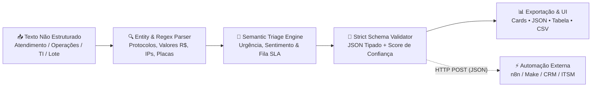

<div align="center">

# 🧩 StructuraAI — Unstructured-to-JSON & Triage Engine
### Extração Estruturada de Dados, Classificação Semântica & Roteamento Operacional com IA

[](https://estrutura-ai-extrator.netlify.app/)
[](https://www.typescriptlang.org/)
[](https://react.dev/)
[](https://tailwindcss.com/)
[](#)

**Convertendo relatos operacionais, tickets de suporte, ocorrências de acesso e lotes de texto livre em payloads JSON tipados sob contrato de Schema, tabelas analíticas e arquivos CSV prontos para integração.**

[🚀 Acessar Aplicação ao Vivo](https://estrutura-ai-extrator.netlify.app/) • [🧠 Arquitetura](#-arquitetura-do-motor-de-extração) • [⚡ Funcionalidades](#-principais-funcionalidades) • [💻 Como Executar](#-como-executar-localmente) • [🧩 Portfólio AI Builder](#-ecossistema-de-projetos-trilha-ai-builder--5-soluções)

</div>

---

## 🧠 Arquitetura do Motor de Extração



---

## ⚡ Principais Funcionalidades

* **🎯 4 Domínios Operacionais Pré-Configurados:** Cenários prontos para **Atendimento & Delivery (CX)**, **Operações & Controle de Acesso**, **Suporte TI & Redes** e **Processamento em Lote (Batch Multi-Registros)**.
* **📜 Contrato JSON Schema Explícito:** Visualização do contrato de tipagem (*Strict Type Enforcement*) que governa a saída estruturada de cada domínio.
* **🏷️ Extração Automática de Entidades:** Identifica e classifica protocolos (`#IFD`, `OS #`, `INC-`), valores financeiros (`R$`), e-mails, endereços IPv4, placas veiculares e registros de horário.
* **🔀 Triagem & Roteamento Inteligente:** Classifica severidade (`CRÍTICA`, `ALTA`, `MÉDIA`, `BAIXA`), ordena filas por criticidade e recomenda a ação operacional imediata.
* **📤 Exportação Multi-Formato & Webhooks:** Visualização alternável entre **Cards de Triagem**, **JSON Bruto** (copiável) e **Tabela Analítica**, com download direto em `.json`, `.csv` e disparo automático para webhooks **n8n / Make**.

---

## 🛠️ Stack Tecnológica

* **Frontend & UI:** React 19, TypeScript, Tailwind CSS v4, Lucide Icons
* **Motor de Extração & Classificação:** Pipeline determinístico + semântico em TypeScript com ordenação por criticidade
* **Integrações:** REST / Webhooks JSON (compatível com n8n, Make, Zapier e APIs de LLMs)
* **Build & CI/CD:** Vite + Deploy contínuo via GitHub e Netlify

---

## 🚀 Como Executar Localmente

```bash
# 1. Clone o repositório
git clone [https://github.com/Rafael777Trajano/structura-ai-extractor.git](https://github.com/Rafael777Trajano/structura-ai-extractor.git)

# 2. Acesse o diretório do projeto
cd structura-ai-extractor

# 3. Instale as dependências
npm install

# 4. Inicie o servidor de desenvolvimento
npm run dev
```

---

## 🧩 Ecossistema de Projetos (Trilha AI Builder — 5 Soluções)

| # | Projeto | Foco Técnico | Status |
| :---: | :--- | :--- | :---: |
| **01** | [**SentinelAI SOC Dashboard**](https://sentinelai-soc-dashboard.netlify.app/) | Monitoramento SOC, visualização de alertas e triagem de segurança | ✅ No Ar |
| **02** | [**NetPulse AI Orchestrator**](https://orquestrador-multi-agente-de-logs-dia.netlify.app/) | Orquestração multi-agente para logs de redes, diagnóstico OSI e SecOps | ✅ No Ar |
| **03** | [**StructuraAI Engine**](https://estrutura-ai-extrator.netlify.app/) *(Este repositório)* | Extração estruturada de dados e classificação operacional a partir de textos livres | ✅ No Ar |
| **04** | **Zero-Backend Webhook Connector** | Integração ágil de eventos operacionais via webhooks (`n8n` / `Make` / `Zapier`) | ⏳ Em Breve (Roadmap) |
| **05** | **OpsProtocol RAG Copilot** | Copiloto de conformidade, consulta rápida a POPs e mediação de crises em tempo real | ⏳ Em Breve (Roadmap) |

---

<div align="center">

### 👨‍💻 Desenvolvido por **Rafael Trajano**
*Tecnólogo em Redes de Computadores • Graduando em Sistemas de Informação*  
**AI Builder | Orquestração de Agentes | Automação de Sistemas | Segurança da Informação**

[](https://www.linkedin.com/in/rafaatrjnbpbs47)
[](https://github.com/Rafael777Trajano)

</div>
